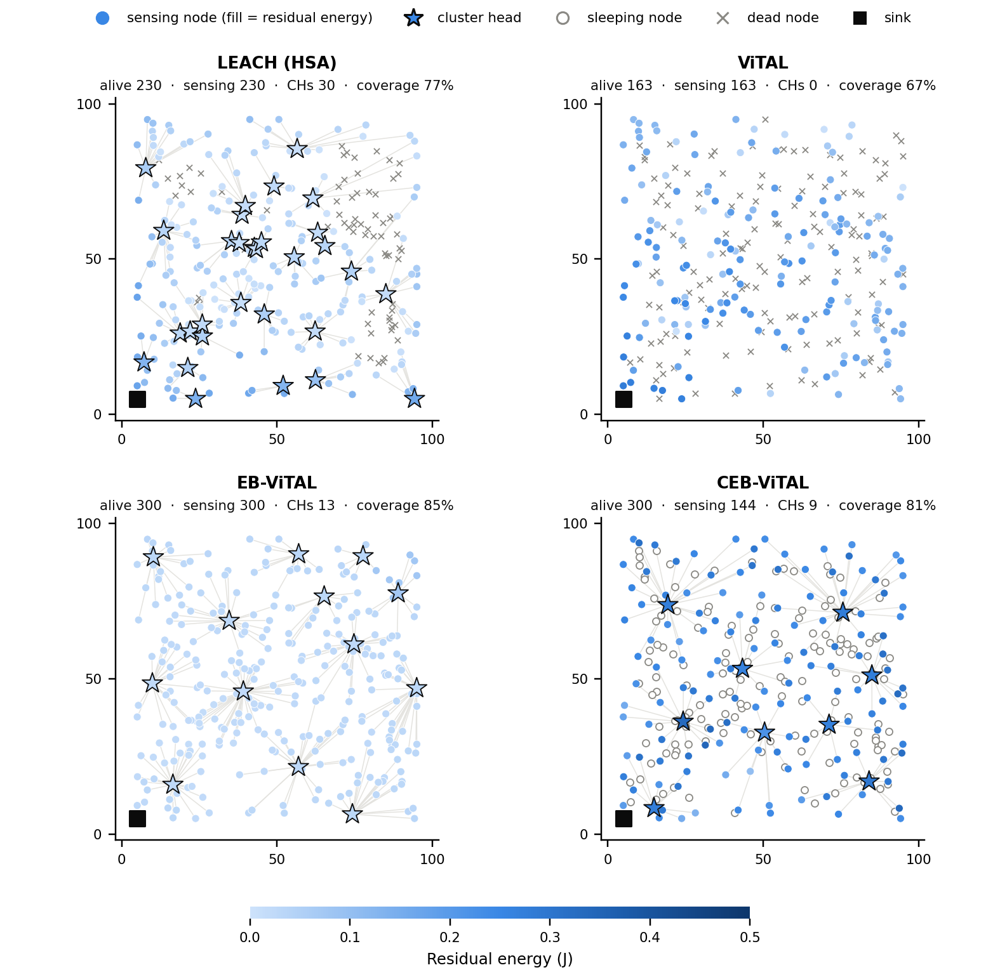
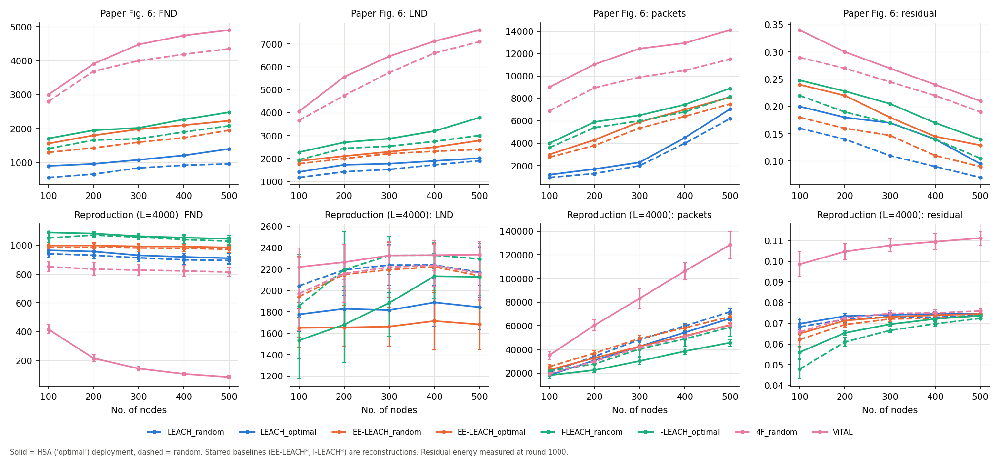
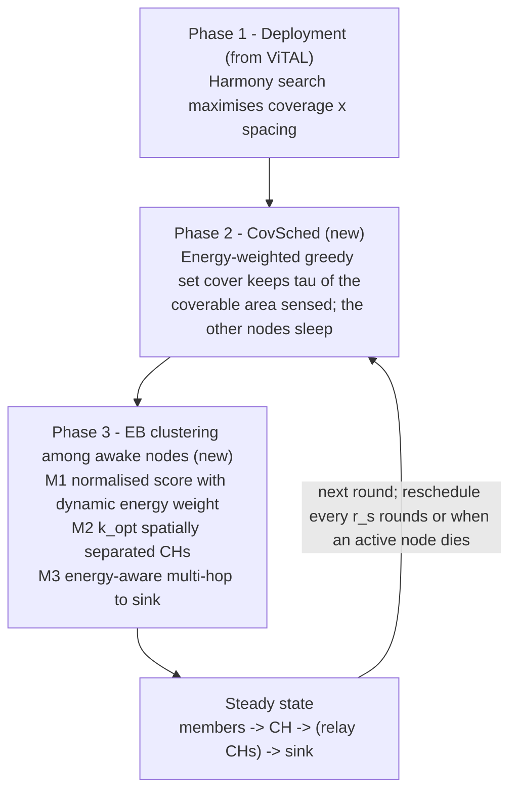
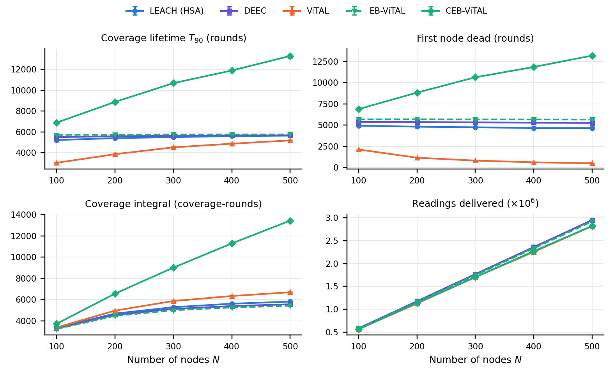
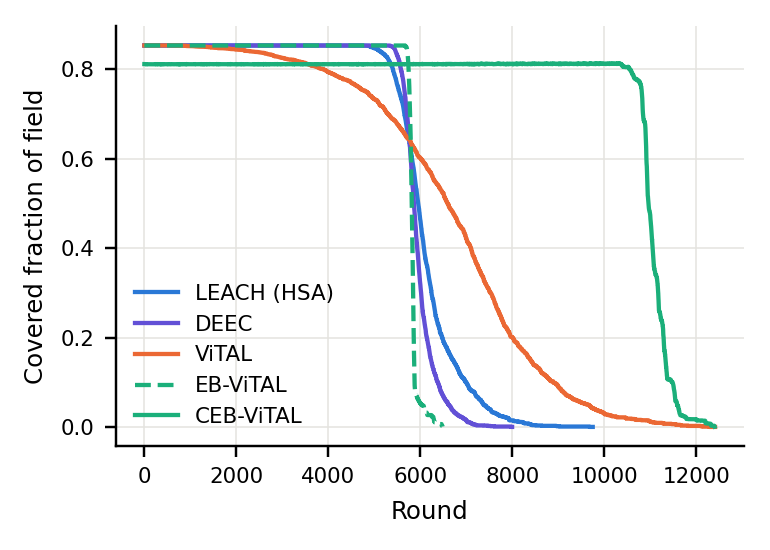
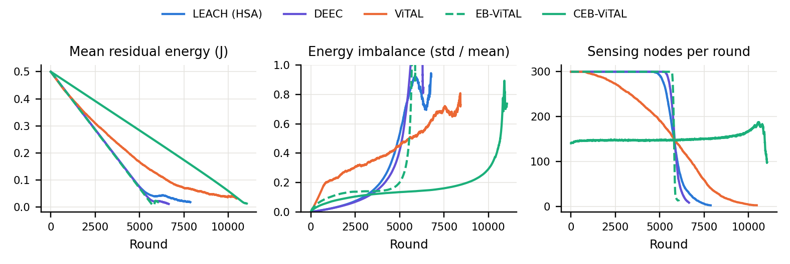
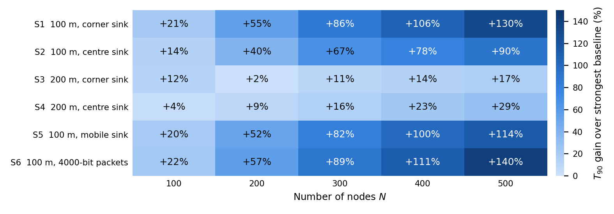
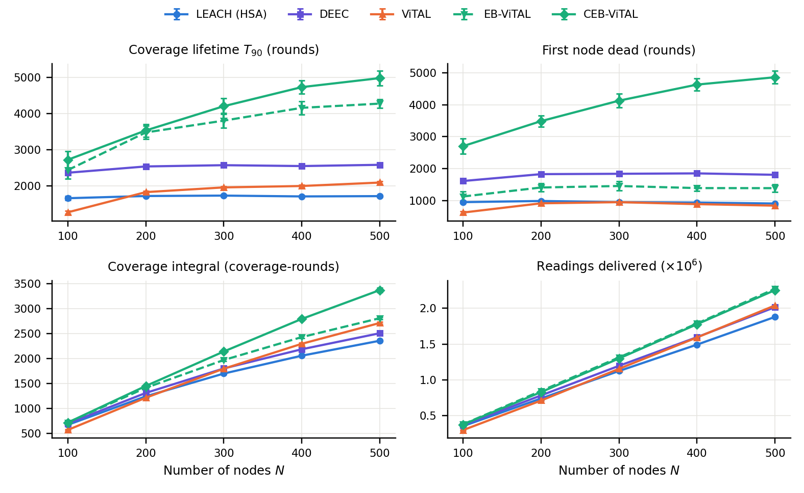

<!-- Generated by CEB-ViTAL_Paper/paper/make_readme.py from README_template.md and the run data. Edit the template, not this file. -->

# CEB-ViTAL

### Coverage-Aware, Energy-Balanced Clustering for Lifetime Extension in Wireless Sensor Networks

**Author:** Ali Hamza
**Status:** research code and data for a manuscript in preparation
**Base paper:** S. J. Ali, J. Iqbal, F. Khan, Y.-K. Moon, "Vigorous technique for augmented lifetime in WSNs," *Scientific Reports* 15, 15400 (2025). [doi:10.1038/s41598-025-96830-w](https://doi.org/10.1038/s41598-025-96830-w)



*One held-out network with 300 nodes at round 5500. LEACH and ViTAL have already lost nodes, and EB-ViTAL's nodes are almost drained. CEB-ViTAL keeps every node alive while only about half of them sense at a time.*

---

## Table of contents

1. [Overview](#1-overview)
2. [Problem statement](#2-problem-statement)
3. [Background: the base paper (ViTAL)](#3-background-the-base-paper-vital)
4. [Research gaps in the published paper](#4-research-gaps-in-the-published-paper)
5. [Our contributions](#5-our-contributions)
6. [Methodology](#6-methodology)
7. [Results](#7-results)
8. [Limitations and threats to validity](#8-limitations-and-threats-to-validity)
9. [Repository structure](#9-repository-structure)
10. [Reproducing the results](#10-reproducing-the-results)
11. [Manuscript](#11-manuscript)
12. [Citation](#12-citation)
13. [License](#13-license)
14. [Author and acknowledgements](#14-author-and-acknowledgements)

---

## 1. Overview

Wireless sensor networks (WSNs) are only useful while they still **cover** the area they monitor. **ViTAL** (Ali et al., 2025) improves WSN lifetime in three phases:

- harmony-search deployment that maximises coverage;
- a connected-dominating-set (CDS) backbone;
- a four-factor cluster-head (CH) score.

This repository does four things:

1. **Re-implements ViTAL** independently from its paper.
2. **Identifies gaps.** ViTAL's CH selection is almost insensitive to residual energy, favours CHs far from the sink, and overloads a small CDS backbone. In addition, the coverage it optimises at deployment is never used during operation.
3. **Proposes CEB-ViTAL.** The new protocol keeps ViTAL's deployment and adds:
   - coverage-preserving, energy-weighted **sleep scheduling**;
   - **corrected, energy-balanced clustering** with an analytically optimal number of well-separated CHs;
   - energy-aware **multi-hop** forwarding.
4. **Evaluates rigorously.** The evaluation is pre-registered and uses 6,900 runs on 30 held-out random networks, 6 scenarios and 100–500 nodes.

**Headline results.** These are for ViTAL's own setting: a 100 m field with the sink at (5, 5).

| CEB-ViTAL compared with | Metric | Change |
|---|---|---|
| Strongest baseline | Coverage lifetime $`T_{90}`$ | **+21% to +130%** |
| LEACH | First node dead | **+40% to +184%** |
| ViTAL (re-implementation) | First node dead | **+224% to +2519%** |
| Strongest baseline | Coverage integral | **+15% to +148%** |
| Always-on baselines | Readings delivered | −4% to +1% |

All pre-registered hypotheses hold, with Holm-corrected p ≤ 6.1 × 10<sup>−6</sup>. Across all six scenarios the $`T_{90}`$ gain ranges from +2% to +140%.

---

## 2. Problem statement

A WSN of $`N`$ battery-powered nodes monitors a field and reports to a sink. Batteries are rarely replaced, so the network's useful life ends when it can no longer sense enough of the field. That moment can come long before the last node dies, and it can also come after the first node dies.

Clustered protocols in the LEACH family save energy by electing cluster heads (CHs) that aggregate their members' data. They still keep **every** node sensing and transmitting every round, even in dense deployments where neighbours already cover most of a node's area. As nodes die unevenly, coverage collapses.

**Goal.** Maximise the **coverage lifetime**

$$T_{90}=\min\{\,r : C(r) < 0.9\,C_0\,\},$$

where $`C(r)`$ is the fraction of the field sensed in round $`r`$ and $`C_0`$ is the initial coverage of the full deployment. Delivered data should stay comparable and every node should be used fairly. The method must also work with ViTAL's coverage-optimised deployment, which is the starting point of this work.

---

## 3. Background: the base paper (ViTAL)

ViTAL ([Ali et al., *Sci. Rep.* 2025](https://doi.org/10.1038/s41598-025-96830-w)) combines three phases:

| Phase | What it does |
|---|---|
| 1. Deployment | Harmony search (HSA) places nodes to maximise the coverage ratio while spreading them apart. |
| 2. Topology | Each node builds a connected dominating set (CDS), and CHs are chosen from the CDS. |
| 3. CH selection | A four-factor score is multiplied into the LEACH threshold, $`\mathrm{ViTAL}=\mathrm{NV}\cdot T(n)`$. |

The four-factor score, Eq. 20 of the base paper, is

$$\mathrm{NV}=w_1\frac{E_{res}}{E_{res}^{total}}+w_2\frac{Neigh}{N}+w_3\frac{Dist}{\overline{Dist}}+w_4\frac{SNR}{\overline{SNR}},\qquad \textstyle\sum_k w_k=1 .$$

The paper reports large gains over LEACH, EE-LEACH and I-LEACH in static and mobile-sink scenarios. Its conclusion names dynamic weighting and scheduling as future work.

---

## 4. Research gaps in the published paper

### 4.1 Methodological gaps (what CEB-ViTAL addresses)

| ID | Gap | Why it matters | Evidence from our simulations |
|---|---|---|---|
| **G1** | The energy term divides a node's energy by the **network total**, so it is about $`1/N`$, while the other three terms are about 1. | CH selection is almost energy-blind: at $`N=100`$ with equal weights the energy term contributes ≈ 0.0025, against ≈ 0.25 for each other term. | A deterministic election using Eq. 20 unchanged drains the same nodes; first-node death falls by 93–97% (v1 study, development seeds). |
| **G2** | $`Dist/\overline{Dist}`$ grows with distance, so the score favours CHs **far** from the sink. The text intends the opposite. | With a corner sink, far CHs pay the $`d^4`$ amplifier cost. | — |
| **G3** | CH candidates are restricted to the CDS, about 28 nodes for any $`N`$. | The CH role concentrates on a small backbone, which dies first. | In our re-implementation, ViTAL's first-node death is −91% to −50% relative to LEACH and falls as $`N`$ grows. |
| **G4** | Coverage is optimised at deployment and then ignored. | In dense deployments many nodes are redundant, yet all of them spend energy every round. | At $`N=500`$, nodes cover 92% of the field, so many sensing areas overlap. |

### 4.2 Reproducibility observations

These were found while re-implementing ViTAL from its text and are reported neutrally; each may be a typesetting or reporting slip. Details are in [`Ali2025_SciRep_ViTAL_WSN_Reproduction/REPORT.md`](Ali2025_SciRep_ViTAL_WSN_Reproduction/REPORT.md).

- **Missing parameters.** No code or data are public. Several parameters needed to run ViTAL are not stated: $`E_{elec}`$, the CH probability $`p`$, the weights $`w_1`$–$`w_4`$, the SNR model and the CDS update rule.
- **Packet size versus baseline numbers.** With the stated 800-bit packets, standard LEACH lives much longer than the paper's LEACH baseline. At $`N=100`$, first-node death is 4844 rounds in our simulation against 560 in the paper. With 4000-bit packets it is 942, and 8000-bit packets give FND 457 and LND 1026, close to the paper. That packet size, however, caps any node's life at 1250 rounds, below the reported ViTAL first-node death of 3000.
- **No setting fits everything.** In a 24-setting scan of packet size and $`E_{elec}`$, none matched the paper's LEACH numbers and still allowed ViTAL's reported lifetimes.
- **Percentage convention.** The headline percentages match $`(V-B)/V`$ computed from the paper's own figures: 81.3%, against the stated 80.9% for first-node death vs LEACH. The usual convention, $`(V-B)/B`$, gives +437% from the same figure.
- **Coverage target.** With $`R_s=5`$ m, 100 nodes can cover at most 78.5% of a 100 × 100 m field, so the stated 90% coverage target cannot be met at $`N=100`$.



*Top row: values digitised from the base paper's Fig. 6. Bottom row: our re-implementation with 4000-bit packets, 30 runs per point.*

---

## 5. Our contributions

1. **Independent re-implementation of ViTAL.** Built from the published text, with every unstated choice pre-registered, and documented reproducibility observations (§4.2).
2. **Gap analysis of ViTAL's CH selection (G1–G4).** Each gap is supported by simulation evidence.
3. **EB-ViTAL (v1).** Corrected clustering:
   - a normalised, direction-corrected four-factor score with a dynamic energy weight;
   - election of the analytically optimal number of spatially separated CHs;
   - energy-aware multi-hop CH-to-sink forwarding.
4. **CEB-ViTAL (v2, main contribution).** EB clustering combined with **CovSched**, a coverage-preserving, energy-weighted greedy sleep scheduler, on top of ViTAL's coverage-optimised deployment.
5. **Rigorous evaluation.** It uses:
   - a shared simulator with a bit-for-bit fairness check;
   - pre-registered hypotheses;
   - 30 held-out test networks;
   - 6 scenarios, including mobile sink, large fields and large packets;
   - ablations and a sleep-energy robustness check;
   - paired non-parametric tests with Holm correction.
6. **Open, regenerable results.** Every number in this README and in the LaTeX manuscript is produced from the raw data by the included scripts.

---

## 6. Methodology

### 6.1 System model

**Radio model.** We use the first-order radio model (Heinzelman et al., 2002), the same one ViTAL uses:

$$E_{TX}(L,d)=\begin{cases}L\,E_{elec}+L\,\varepsilon_{fs}\,d^{2}, & d<d_0\\ L\,E_{elec}+L\,\varepsilon_{mp}\,d^{4}, & d\ge d_0\end{cases},\qquad E_{RX}(L)=L\,E_{elec},\qquad d_0=\sqrt{\varepsilon_{fs}/\varepsilon_{mp}}$$

**Coverage model.** As in ViTAL, the field is divided into 1 m cells. Node $`i`$ covers cell $`c`$ if $`\lVert p_c-x_i\rVert\le R_s`$. With $`\mathcal{A}(r)`$ the set of sensing nodes in round $`r`$,

$$C(r)=\frac{1}{M^2}\Big|\bigcup_{i\in\mathcal{A}(r)}\mathcal{C}_i\Big| .$$

| Parameter | Value |
|---|---|
| Field | 100 × 100 m (200 × 200 m in S3 and S4) |
| Nodes $`N`$ | 100, 200, 300, 400, 500 |
| $`E_0`$ | 0.5 J |
| $`E_{elec}`$, $`E_{DA}`$ | 50 nJ/bit, 5 nJ/bit/signal |
| $`\varepsilon_{fs}`$, $`\varepsilon_{mp}`$ | 10 pJ/bit/m², 0.0013 pJ/bit/m⁴ |
| Packet $`L`$ | 800 bits (4000 bits in S6) |
| Sensing range / neighbour range | 5 m / 15 m |
| CovSched | τ = 0.95, rescheduled every 10 rounds, 200-bit schedule message |

### 6.2 CEB-ViTAL



**Phase 2: CovSched.** Every $`r_s=10`$ rounds, and whenever an active node dies, the sink computes the active set greedily:

```
U  <- cells coverable by all alive nodes;   A <- {};   K <- {}
while |K| < tau * |U|:
    i* <- argmax over alive i not in A of  |C_i \ K| * E_i / max_j E_j
    if |C_i* \ K| == 0: break
    A <- A + {i*};   K <- K + C_i*
broadcast A; all other alive nodes sleep (no sensing, no transmission)
```

Every alive node pays the energy of receiving a 200-bit schedule each time the schedule is recomputed.

**Phase 3: EB clustering among awake nodes.**

- **M1, normalised score.** Each factor is scaled to [0, 1], the distance preference is inverted so that nodes near the sink score higher (fixes G1 and G2), and the energy weight grows as the network drains (the paper's future work):

$$s_i=w_1(t)\frac{E_i}{\max E}+w(t)\Big[\frac{Neigh_i}{\max Neigh}+\Big(1-\frac{Dist_i}{\max Dist}\Big)+\frac{SNR_i}{\max SNR}\Big],\quad w_1(t)=0.25+0.5\Big(1-\frac{\bar E(t)}{E_0}\Big),\; w=\frac{1-w_1}{3}$$

- **M2, optimal number of separated CHs (fixes G3).** Candidates are taken in descending $`s_i`$ and accepted only if they lie at least $`r_{sep}=\sqrt{M^2/(\pi k)}`$ from every chosen CH, where

$$k=\mathrm{round}\Big(\sqrt{\tfrac{n}{2\pi}}\sqrt{\tfrac{\varepsilon_{fs}}{\varepsilon_{mp}}}\,\frac{M}{\bar d^{\,2}}\Big)$$

- **M3, multi-hop forwarding.** The sink computes a shortest-path tree over the CHs. The cost of a link from CH $`i`$ to CH $`j`$ is $`E_{TX}(L,d_{ij})+L\,E_{elec}\,\bar E/E_j`$.

**Complexity.** One schedule costs $`O(|\mathcal{A}|\cdot nnz)`$, where $`nnz\approx 78N`$ node–cell incidences. One election costs $`O(N\log N+kN)`$, and routing costs $`O(k^2)`$. Like LEACH-C and ViTAL, the method is coordinated by the sink.

### 6.3 Research path

1. **Re-implementation of ViTAL** (`Ali2025_SciRep_ViTAL_WSN_Reproduction/`). This revealed G1–G4 and the observations in §4.2.
2. **EB-ViTAL v1** (`EBViTAL_Novelty_on_Ali2025/`), development seeds only. Corrected clustering alone extended first-node death by +15% to +22% over LEACH. Because energy was so evenly balanced, the network then died abruptly: last-node death changed by −31% to −26% and readings by −2% to −1%. This weakness motivated v2.
3. **CEB-ViTAL v2** (`CEB-ViTAL_Paper/`). Coverage-preserving scheduling was added, and the design was frozen before evaluation on new, held-out networks.

### 6.4 Experimental design

- **Fairness check.** All protocols share one round-based simulator: the same radio model, the same deployments and the same random streams. Before testing, the simulator reproduced 7,620 earlier runs **bit-for-bit**.
- **Pre-registration.** Constants, scenarios, metrics and hypotheses were frozen in [`PREREGISTRATION_v2.md`](CEB-ViTAL_Paper/PREREGISTRATION_v2.md) before any test run.
- **Held-out test set.** All reported results use 30 networks with seeds 1000–1029, never used during development.
- **Metrics.**
  - Primary: $`T_{90}`$.
  - Secondary: $`T_{50}`$, the coverage integral $`\sum_r C(r)`$, first/half/last node death (FND, HND, LND) and readings delivered.
- **Statistics.**
  - Hypotheses H1–H3 (CEB-ViTAL beats each comparator on $`T_{90}`$, coverage integral and FND in S1) are tested with one-sided paired Wilcoxon tests and Holm correction over 20 tests each.
  - All other values are reported as mean ± 95% CI.

**Table S. Scenarios.** Every scenario uses E0 = 0.5 J, Rs = 5 m, N = 100–500 and 30 seeds per point.

| ID | Field | Sink | Packet |
|---|---|---|---|
| S1 | 100 × 100 m | (5,5), static (base paper) | 800 bits |
| S2 | 100 × 100 m | (50,50), static | 800 bits |
| S3 | 200 × 200 m | (5,5), static | 800 bits |
| S4 | 200 × 200 m | (100,100), static | 800 bits |
| S5 | 100 × 100 m | random waypoint, 1–10 m/s, 10 s pause | 800 bits |
| S6 | 100 × 100 m | (5,5), static | 4000 bits |

**Compared protocols.**

- **Baselines:**
  - LEACH, on random and on HSA deployment;
  - DEEC;
  - ViTAL, our re-implementation;
  - EB-ViTAL, always on.
- **Ablations:**
  - LEACH + CovSched;
  - EB-ViTAL + RandSleep, with the same number of sleepers but chosen at random;
  - CEB-ViTAL without M3.

---

## 7. Results

### 7.1 Base setting (S1: 100 m field, sink at (5, 5), 800-bit packets)

**Table 1a. S1 lifetimes in rounds**, mean ± 95% CI over 30 held-out seeds.

| Protocol | T90, N=100 | T90, N=300 | T90, N=500 | FND, N=100 | FND, N=300 | FND, N=500 |
|---|---|---|---|---|---|---|
| LEACH (random) | 5170 ± 27 | 5386 ± 18 | 5505 ± 16 | 4825 ± 46 | 4665 ± 46 | 4549 ± 53 |
| LEACH (HSA) | 5230 ± 21 | 5508 ± 18 | 5652 ± 13 | 4931 ± 39 | 4750 ± 42 | 4650 ± 37 |
| DEEC | 5502 ± 18 | 5639 ± 11 | 5674 ± 10 | 5378 ± 22 | 5330 ± 24 | 5257 ± 17 |
| ViTAL | 3048 ± 60 | 4529 ± 86 | 5193 ± 61 | 2127 ± 38 | 818 ± 20 | 504 ± 17 |
| EB-ViTAL | 5716 ± 17 | 5758 ± 10 | 5767 ± 6 | 5676 ± 37 | 5667 ± 33 | 5650 ± 24 |
| LEACH + CovSched | 5632 ± 22 | 6645 ± 54 | 8411 ± 148 | 5621 ± 22 | 6621 ± 55 | 8324 ± 148 |
| **CEB-ViTAL** | 6900 ± 58 | 10686 ± 55 | 13290 ± 181 | 6889 ± 59 | 10642 ± 57 | 13195 ± 180 |

**Table 1b. S1 last node death (rounds), coverage integral (coverage-rounds) and readings delivered (×10³).**

| Protocol | LND, N=100 | LND, N=500 | Cov. integral, N=100 | Cov. integral, N=500 | Readings, N=100 | Readings, N=500 |
|---|---|---|---|---|---|---|
| LEACH (random) | 10087 ± 543 | 11187 ± 324 | 3075 ± 37 | 6025 ± 11 | 586.1 ± 2.8 | 2944.6 ± 2.9 |
| LEACH (HSA) | 8954 ± 330 | 9272 ± 368 | 3346 ± 35 | 5814 ± 21 | 584.8 ± 1.3 | 2944.5 ± 2.4 |
| DEEC | 7447 ± 375 | 7949 ± 448 | 3287 ± 35 | 5560 ± 20 | 580.3 ± 1.1 | 2948.5 ± 2.2 |
| ViTAL | 11376 ± 289 | 11696 ± 216 | 3375 ± 37 | 6695 ± 37 | 565.5 ± 3.5 | 2816.3 ± 10.5 |
| EB-ViTAL | 6039 ± 368 | 6760 ± 459 | 3240 ± 38 | 5426 ± 25 | 575.0 ± 1.5 | 2919.3 ± 2.8 |
| LEACH + CovSched | 9226 ± 324 | 18222 ± 442 | 3502 ± 27 | 10744 ± 69 | 573.8 ± 1.3 | 2858.7 ± 3.1 |
| **CEB-ViTAL** | 7294 ± 309 | 16415 ± 193 | 3723 ± 24 | 13440 ± 62 | 566.8 ± 1.7 | 2820.0 ± 2.9 |



- **Coverage lifetime grows with density**, because more nodes are redundant. At $`N=300`$, CEB-ViTAL reaches $`T_{90}=`$ 10686 rounds, against 5758 for the strongest always-on protocol.
- **Readings delivered** differ by −4% to +1% from the always-on protocols, because sleeping nodes do not report.
- Last-node death is not uniformly better. At N = 100, CEB-ViTAL's LND (7294 rounds) is below LEACH (HSA) (8954) and ViTAL (11376). At N = 500 it exceeds every always-on baseline (16415 vs at most 11696).

### 7.2 Pre-registered hypotheses

**Table 2. Pre-registered hypotheses in S1.** One-sided paired Wilcoxon over 30 held-out seeds, with Holm correction over 20 tests per hypothesis.

| Hypothesis | Comparator | CEB-ViTAL gain (N = 100–500) | Largest Holm p | Significant N |
|---|---|---|---|---|
| H1 (T90) | LEACH (HSA) | +32% to +135% | 5.2e-06 | 5/5 |
| H1 (T90) | DEEC | +25% to +134% | 5.2e-06 | 5/5 |
| H1 (T90) | ViTAL | +126% to +156% | 5.2e-06 | 5/5 |
| H1 (T90) | EB-ViTAL | +21% to +130% | 5.2e-06 | 5/5 |
| H2 (cov_int) | LEACH (HSA) | +11% to +131% | 1.9e-08 | 5/5 |
| H2 (cov_int) | DEEC | +13% to +142% | 1.9e-08 | 5/5 |
| H2 (cov_int) | ViTAL | +10% to +101% | 1.9e-08 | 5/5 |
| H2 (cov_int) | EB-ViTAL | +15% to +148% | 1.9e-08 | 5/5 |
| H3 (FND) | LEACH (HSA) | +40% to +184% | 6.1e-06 | 5/5 |
| H3 (FND) | DEEC | +28% to +151% | 6.1e-06 | 5/5 |
| H3 (FND) | ViTAL | +224% to +2519% | 6.1e-06 | 5/5 |
| H3 (FND) | EB-ViTAL | +21% to +134% | 6.1e-06 | 5/5 |

All three hypotheses are supported in **all 20 comparisons**.

### 7.3 Why it works



**Coverage over time, $`N=300`$.** CEB-ViTAL deliberately runs at about τ = 95% of the always-on coverage, and keeps that level roughly twice as long. Always-on protocols lose coverage as soon as nodes start dying.



**Network dynamics, $`N=300`$, 10 networks.**

- **Energy use.** Only about 148 of 300 nodes sense each round, so mean residual energy falls roughly half as fast.
- **Energy imbalance.** For the always-on protocols, the spread of residual energy rises sharply once nodes start dying. CEB-ViTAL's stays low until the network approaches exhaustion.

**Network snapshot at round 5500** (figure at the top of this page):

| Protocol | State |
|---|---|
| LEACH (HSA) | 230 alive, 230 sensing, 30 CHs, 77% coverage, mean residual energy 0.05 J |
| ViTAL | 163 alive, 163 sensing, 0 CHs, 67% coverage, mean residual energy 0.15 J |
| EB-ViTAL | 300 alive, 300 sensing, 13 CHs, 85% coverage, mean residual energy 0.03 J |
| CEB-ViTAL | 300 alive, 144 sensing, 9 CHs, 81% coverage, mean residual energy 0.27 J |

### 7.4 All scenarios



**Table 3. CEB-ViTAL against the strongest always-on baseline** (highest mean T90 among LEACH (HSA), DEEC, ViTAL and EB-ViTAL).

| Scenario | N | Strongest baseline | T90 | FND | Coverage integral | LND | Readings |
|---|---|---|---|---|---|---|---|
| S1 | 100 | EB-ViTAL | +21% | +21% | +15% | +21% | −1% |
| S1 | 300 | EB-ViTAL | +86% | +88% | +80% | +89% | −2% |
| S1 | 500 | EB-ViTAL | +130% | +134% | +148% | +143% | −3% |
| S2 | 100 | EB-ViTAL | +14% | +17% | +11% | +7% | −1% |
| S2 | 300 | ViTAL | +67% | +696% | +27% | +24% | −15% |
| S2 | 500 | ViTAL | +90% | +1561% | +68% | +75% | −16% |
| S3 | 100 | EB-ViTAL | +12% | +141% | 0% | +1% | −1% |
| S3 | 300 | EB-ViTAL | +11% | +184% | +9% | +11% | −1% |
| S3 | 500 | EB-ViTAL | +17% | +251% | +20% | +18% | −1% |
| S4 | 100 | EB-ViTAL | +4% | +7% | 0% | +5% | −2% |
| S4 | 300 | EB-ViTAL | +16% | +18% | +11% | +19% | −3% |
| S4 | 500 | EB-ViTAL | +29% | +30% | +24% | +37% | −3% |
| S5 | 100 | EB-ViTAL | +20% | +20% | +15% | +24% | −1% |
| S5 | 300 | DEEC | +82% | +89% | +76% | +93% | −2% |
| S5 | 500 | ViTAL | +114% | +2036% | +82% | +66% | −9% |
| S6 | 100 | EB-ViTAL | +22% | +22% | +16% | +22% | 0% |
| S6 | 300 | EB-ViTAL | +89% | +91% | +82% | +92% | −1% |
| S6 | 500 | EB-ViTAL | +140% | +141% | +148% | +147% | −1% |

- **Gains depend on redundancy.** In the sparse 200 m field (S3), 100 nodes cover only 19% of the area, so the $`T_{90}`$ gain is +2% to +17%. In the 100 m field, 100 nodes cover 56% and 500 nodes cover 92%.
- **Other settings.** The mobile sink (S5) and 4000-bit packets (S6) reproduce the S1 pattern.



### 7.5 Ablation

**Table 4. Ablation.** Change in CEB-ViTAL relative to each variant, shown as T90 / FND / coverage integral. '≈0†' means the variant's mean T90 is below 100 rounds, so a ratio is meaningless.

| Scenario | Variant | N = 100 | N = 300 | N = 500 |
|---|---|---|---|---|
| S1 | no CovSched (always on) | +21% / +21% / +15% | +86% / +88% / +80% | +130% / +134% / +148% |
| S1 | random sleepers, same count | ≈0† / −1% / +10% | ≈0† / −9% / +17% | ≈0† / −26% / +12% |
| S1 | LEACH clustering instead of EB | +23% / +23% / +6% | +61% / +61% / +23% | +58% / +59% / +25% |
| S1 | no multi-hop (M3) | +0% / +0% / 0% | +0% / +0% / +0% | +0% / +0% / +0% |
| S3 | no CovSched (always on) | +12% / +141% / 0% | +11% / +184% / +9% | +17% / +251% / +20% |
| S3 | random sleepers, same count | +35% / +129% / +1% | ≈0† / +137% / +7% | ≈0† / +146% / +10% |
| S3 | LEACH clustering instead of EB | +41% / +41% / +8% | +110% / +108% / +24% | +140% / +138% / +36% |
| S3 | no multi-hop (M3) | +3% / +3% / +3% | 0% / +1% / +2% | +2% / +4% / +3% |

- **Scheduling.** Adding CovSched to EB clustering changes $`T_{90}`$ by +21% to +130% in S1 and by +2% to +17% in S3.
- **Coverage-aware selection is essential.** Sleeping the same number of nodes chosen at random drops coverage below 0.9 C₀ within the first rounds in all but the sparsest settings.
- **Clustering.** CEB-ViTAL beats LEACH + CovSched by +23% to +61% in S1 and by +41% to +140% in S3. In the sparse field the clustering phase matters more than the scheduler.
- **Multi-hop forwarding (M3)** has no measurable effect in the 100 m fields. In the 200 m corner-sink field its effect is 0% to +3%.

### 7.6 Robustness to sleep energy (post hoc)

The radio model treats sleep as free. This check, which was not pre-registered, charges every sleeping node $`f\cdot L\cdot E_{elec}`$ per round.

**Table 5. Sleep-energy robustness (post hoc).** CEB-ViTAL against the strongest always-on baseline, shown as T90 / FND / coverage integral. Each sleeping node pays f · L · Eelec per round.

| Scenario | N | f = 0 | f = 0.05 | f = 0.25 | f = 1 |
|---|---|---|---|---|---|
| S1 | 100 | +21% / +21% / +15% | +20% / +21% / +14% | +18% / +18% / +12% | +10% / +10% / +4% |
| S1 | 300 | +86% / +88% / +80% | +83% / +86% / +78% | +75% / +75% / +66% | +37% / +35% / +28% |
| S1 | 500 | +130% / +134% / +148% | +125% / +128% / +141% | +108% / +105% / +115% | +56% / +49% / +45% |
| S3 | 100 | +12% / +141% / 0% | +11% / +140% / 0% | +10% / +137% / 0% | +6% / +129% / −1% |
| S3 | 300 | +11% / +184% / +9% | +10% / +182% / +9% | +6% / +174% / +7% | −3% / +144% / +3% |
| S3 | 500 | +17% / +251% / +20% | +15% / +248% / +20% | +10% / +234% / +17% | +0% / +157% / +9% |

- **S1.** The $`T_{90}`$ advantage survives even at $`f=1`$, where sleeping costs as much as the electronics of sending one packet: +10% to +56%.
- **S3.** In the sparse field, the $`T_{90}`$ advantage disappears at $`f=1`$ (−3% to +6%).

### 7.7 Summary of findings

1. **ViTAL's CH selection can be improved.** Correcting its normalisation and spreading the CHs extends the stability period.
2. **Coverage-aware sleeping is the larger gain in dense networks.** Coupling it with balanced clustering extends coverage lifetime by +21% to +130% in ViTAL's own setting, with little change in delivered readings.
3. **Gains scale with redundancy.** They are largest in dense networks and smallest in sparse ones.

---

## 8. Limitations and threats to validity

- **Baseline fidelity.** ViTAL is re-implemented from its paper. Its unpublished parameters had to be assumed, so our absolute ViTAL numbers differ from those printed in the base paper. LEACH and DEEC are fully specified.
- **Model scope.**
  - The study uses the first-order radio model, with no packet loss, MAC contention or idle listening.
  - Data links are not limited by radio range, as in LEACH-type studies.
  - Sleep is free in the main runs; §7.6 bounds that assumption.
- **Coverage trade-off.** CEB-ViTAL holds about 95% of the coverable area (τ = 0.95). Applications that need every cell at every instant should raise τ.
- **Centralised control.** The scheduler and the CH election run at the sink, as in LEACH-C and ViTAL.
- **Untuned constants.** τ, the reschedule interval and the M1 weight schedule were fixed a priori and not tuned.

---

## 9. Repository structure

```
.
├── README.md                                  # this file (generated)
├── Ali2025_SciRep_ViTAL_WSN_Reproduction/     # step 1: re-implementation of ViTAL
│   ├── PREREGISTRATION.md                     #   assumptions fixed before running
│   ├── vital_repro.py                         #   simulator (LEACH, EE-LEACH*, I-LEACH*, 4F, ViTAL)
│   ├── run_experiments.py, extra_experiments.py, analyze.py
│   ├── paper_digitized/paper_values.json      #   values read from the paper's figures
│   ├── results/, figures/                     #   raw runs, summary tables, plots
│   └── REPORT.md                              #   reproduction report
├── EBViTAL_Novelty_on_Ali2025/                # step 2: EB-ViTAL v1
│   ├── DESIGN_AND_PREREGISTRATION.md, wsn_sim.py, run_experiments.py, analyze.py
│   ├── results/, figures/
│   └── PROPOSAL_AND_RESULTS.md
└── CEB-ViTAL_Paper/                           # step 3: CEB-ViTAL (main contribution)
    ├── PREREGISTRATION_v2.md                  #   frozen design, hypotheses, tests
    ├── ceb_sim.py                             #   simulator (all protocols, CovSched, RandSleep)
    ├── run_experiments.py                     #   fairness gate + 6,900 held-out runs
    ├── robustness_sleep_cost.py               #   post-hoc sleep-energy check
    ├── analyze.py                             #   statistics, tables, figures
    ├── results/                               #   raw runs (JSON), deployments, tables (CSV/LaTeX)
    ├── figures/                               #   all figures (PNG/PDF)
    ├── paper/                                 #   builders for the draft, LaTeX assets and this README
    └── latex/                                 #   IEEEtran manuscript (main.tex, refs.bib, figures, tables)
```

---

## 10. Reproducing the results

**Requirements.** Python ≥ 3.10 with `numpy`, `scipy` and `matplotlib`, plus `pdflatex` and `bibtex` for the manuscript. A multi-core machine is recommended: the full study takes about one hour on 64 cores.

```bash
cd CEB-ViTAL_Paper
python3 ceb_sim.py                  # self-checks
python3 run_experiments.py          # fairness gate (7,620 runs) + 6,900 test runs
python3 robustness_sleep_cost.py    # post-hoc sleep-energy check (1,080 runs)
python3 analyze.py                  # statistics -> results/summary.md, figures/

cd paper
python3 make_latex_assets.py        # LaTeX macros and tables
python3 make_paper_figures.py       # journal-size figures
python3 make_extra_figures.py       # snapshot, heatmap, dynamics
python3 make_readme.py              # regenerates this README

cd ../latex
pdflatex main && bibtex main && pdflatex main && pdflatex main
```

All randomness is seeded, so the same commands reproduce the same numbers.

---

## 11. Manuscript

The IEEEtran manuscript is in [`CEB-ViTAL_Paper/latex/`](CEB-ViTAL_Paper/latex/), and a compiled PDF is at [`latex/main.pdf`](CEB-ViTAL_Paper/latex/main.pdf). Its tables and numbers are `\input` from generated files, so the manuscript always matches the data.

- **Overleaf.** Upload the `latex/` folder as a zip.
- **VS Code.** With LaTeX Workshop, the build recipe in `.vscode/settings.json` compiles it on save.

---

## 12. Citation

If you use this code or data, please cite this repository and the base paper:

```bibtex
@misc{hamza2026cebvital,
  author       = {Ali Hamza},
  title        = {{CEB-ViTAL}: Coverage-Aware, Energy-Balanced Clustering for Lifetime Extension in Wireless Sensor Networks},
  year         = {2026},
  howpublished = {\url{https://github.com/ali-Hamza817/CEB-Vital}}
}

@article{ali2025vital,
  author  = {Sardar Jaffar Ali and Javed Iqbal and Faheem Khan and Yeon-Kug Moon},
  title   = {Vigorous technique for augmented lifetime in {WSNs}},
  journal = {Scientific Reports},
  volume  = {15},
  pages   = {15400},
  year    = {2025},
  doi     = {10.1038/s41598-025-96830-w}
}
```

---

## 13. License

No license has been chosen yet. Until one is added, all rights are reserved by the author.

---

## 14. Author and acknowledgements

**Ali Hamza**: design, implementation, experiments and analysis.

This work builds on ViTAL by S. J. Ali, J. Iqbal, F. Khan and Y.-K. Moon (*Scientific Reports*, 2025). It also uses the classic LEACH, LEACH-C and DEEC protocols, the harmony-search deployment model, and the IEEEtran LaTeX class.
